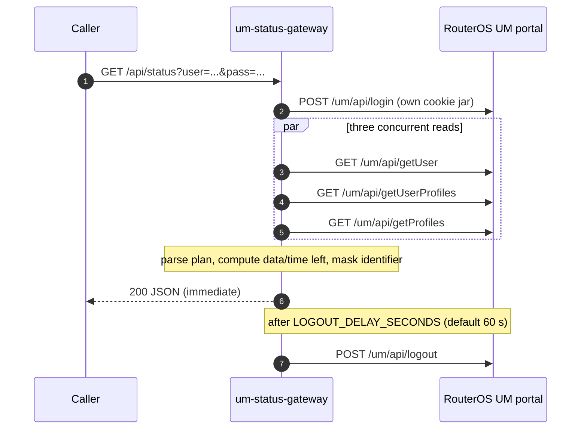

# um-status-gateway

An ultra-lightweight, on-demand HTTP gateway for the **MikroTik RouterOS v7 User Manager** web portal. It answers one question, quickly and cheaply: *how much data, time and validity is left for this account right now?*

The service is a single static Go binary, shipped as a `scratch` container image, and it does nothing until an HTTP request arrives. There is no polling loop, no background worker, no cache and no shared session: every request opens its own isolated portal session, reads the account data, computes the balances, masks the account identifier, schedules a delayed logout, and returns JSON.

[](https://github.com/hashed-albaham/mikrotik-um-gateway/actions/workflows/docker-build.yml)

## Request lifecycle



Everything above happens inside the lifetime of a single HTTP request, except the logout, which is a single one-shot timer created per request.

## API

### `GET /api/status?user=<id>&pass=<password>`

| Parameter | Required | Notes |
|---|---|---|
| `user` | yes | Account identifier, up to 128 characters. Never echoed back in plain form. |
| `pass` | no | Portal password, up to 256 characters. Empty string is sent when omitted. |

Successful response (`200`):

```json
{
  "success": true,
  "masked_user": "00******58",
  "data_left": { "unit": "bytes", "raw": 916455424, "human": "874 MB", "unlimited": false },
  "time_left": { "unit": "seconds", "raw": 23400, "human": "6h 30m", "unlimited": false },
  "remaining_validity": { "unit": "seconds", "raw": 23400, "human": "6h 30m", "unlimited": false },
  "total_validity": { "unit": "seconds", "raw": 28800, "human": "8h", "unlimited": false },
  "profile_state": "active",
  "active_sessions": 2,
  "profile": "1000-1G-8h",
  "data_used": { "unit": "bytes", "raw": 157286400, "human": "150 MB", "unlimited": false },
  "time_used": { "unit": "seconds", "raw": 5400, "human": "1h 30m", "unlimited": false },
  "limits_source": "profile-name-syntax",
  "generated_at": "2026-10-12T19:29:07Z"
}
```

| Field | Meaning |
|---|---|
| `masked_user` | Identifier with the middle removed (`0018067158` → `00******58`). The plain value is never returned. |
| `data_left` | Plan allowance minus (download + upload). `raw` is bytes, `unlimited: true` means the plan has no data cap (then `raw` is `-1`). |
| `time_left` | Plan duration minus used uptime. `raw` is seconds; `unlimited: true` when the plan has no time cap. |
| `remaining_validity` | Time until the profile's `end-time`, or the remaining plan duration when no `end-time` was reported. |
| `total_validity` | Full plan duration from the profile. |
| `profile_state` | `active`, `expired`, or `unknown`. User Manager `running`/`running active` map to `active`, `used` maps to `expired`. |
| `active_sessions` | Concurrent sessions of the account, from the portal counter or by counting active session rows. |
| `data_used`, `time_used` | Counters as reported by the portal, for transparency. Omitted when the portal did not report them. |
| `validity_ends_at` | RFC 3339 timestamp of the profile end, omitted when unknown. |
| `limits_source` | Where the plan limits came from: `profile-record-limits`, `profile-name-syntax`, or `unavailable`. |
| `warnings` | Present only when part of the picture was missing, for example counters or limits that the portal did not return. |

Every response carries `Access-Control-Allow-Origin` (default `*`), `Cache-Control: no-store`, and the `Vary: Origin` header.

Error responses use a stable machine readable code:

```json
{ "success": false, "code": "login_failed", "error": "could not open a user manager session" }
```

| HTTP | `code` | Cause |
|---|---|---|
| 400 | `missing_user` | The `user` parameter is absent or blank. |
| 400 | `invalid_user`, `invalid_password` | A parameter exceeds the accepted length. |
| 404 | `not_found` | Unknown path. |
| 500 | `configuration_error` | `UM_HOST` is missing or not a valid `http`/`https` URL. |
| 502 | `login_failed` | The portal rejected the credentials or did not answer. |
| 502 | `fetch_failed` | Login succeeded but one of the three reads failed. |

Error bodies never contain the account identifier, the password, or portal prose.

### `GET /healthz`

Returns `{"status":"ok","logout_delay_seconds":60}`. Useful for container health checks.

## Configuration

| Variable | Default | Description |
|---|---|---|
| `UM_HOST` | *(required)* | Base URL of the User Manager portal, for example `http://192.168.88.1`. The gateway appends `/um/api/...`. A missing scheme defaults to `http://`. |
| `LISTEN_ADDR` | `:8080` | Address the HTTP API binds to. |
| `LOGOUT_DELAY_SECONDS` | `60` | Delay before the portal session of a request is invalidated. `0` disables the delayed logout. |
| `REQUEST_TIMEOUT_SECONDS` | `15` | Timeout for the login plus the three reads. |
| `ALLOWED_ORIGIN` | `*` | Value of `Access-Control-Allow-Origin`. Set an explicit origin in production when the dashboard is hosted at a known URL. |
| `RELEASE_MEMORY_ON_SESSION_END` | `true` | Return the memory of a finished session to the operating system right after its delayed logout, and close idle sockets. This is what keeps the footprint flat on a router. |
| `GOGC`, `GOMEMLIMIT` | `20`, `4MiB` | Go runtime tuning baked into the image. Override to trade latency for an even smaller heap. |

## Build and run

Local run against a real router:

```bash
go build -o bin/um-status-gateway .
UM_HOST=http://192.168.88.1 ./bin/um-status-gateway
curl "http://127.0.0.1:8080/api/status?user=0018067158&pass=secret"
```

Try it without a router: the repository ships a development stub of the portal.

```bash
python3 scripts/mock-um-portal.py 8099 &
UM_HOST=http://127.0.0.1:8099 ./bin/um-status-gateway
curl "http://127.0.0.1:8080/api/status?user=0018067158&pass=demo"
```

Container:

```bash
docker build -t um-status-gateway .
docker run --rm -p 8080:8080 -e UM_HOST=http://192.168.88.1 um-status-gateway
# or
docker compose up --build
```

Multi-architecture build and publish:

```bash
make image-multiarch IMAGE=ghcr.io/hashed-albaham/mikrotik-um-gateway TAG=latest
```

## Deploy on MikroTik RouterOS v7

Run these on the router. Replace `disk1` with your storage and `192.168.88.1` with the router's LAN address.

```routeros
# 1. Enable container mode (requires a physical confirmation, see the RouterOS docs).
/system/device-mode/update container=yes

# 2. Give the container its own network.
/interface/veth/add name=veth1 address=172.17.0.2/24 gateway=172.17.0.1
/interface/bridge/add name=containers
/ip/address/add address=172.17.0.1/24 interface=containers
/interface/bridge/port/add bridge=containers interface=veth1
/ip/firewall/nat/add chain=srcnat action=masquerade src-address=172.17.0.0/24

# 3. Environment variables for the gateway. 172.17.0.1 is the router itself,
#    where the User Manager portal is listening.
/container/envs/add list=ENV_UMGW key=UM_HOST value="http://172.17.0.1"
/container/envs/add list=ENV_UMGW key=LOGOUT_DELAY_SECONDS value="60"
/container/envs/add list=ENV_UMGW key=ALLOWED_ORIGIN value="*"

# 4. Point the container engine at GHCR and pull the image.
/container/config/set registry-url=https://ghcr.io tmpdir=disk1/tmp memory-high=64M
/container/add remote-image=ghcr.io/hashed-albaham/mikrotik-um-gateway:latest \
    interface=veth1 root-dir=disk1/images/umgw envlist=ENV_UMGW name=umgw \
    start-on-boot=yes logging=yes

# 5. Wait for status=stopped (download and extraction finished), then start it.
/container/print
/container/start umgw

# 6. Publish the API on the router's LAN address.
/ip/firewall/nat/add chain=dstnat action=dst-nat protocol=tcp dst-address=192.168.88.1 \
    dst-port=8080 to-addresses=172.17.0.2 to-ports=8080

# Operations
/container/print
/container/log/print            # when logging=yes
/container/shell umgw
/container/update umgw          # pull a newer image tag
/container/stop umgw
```

The service speaks plain HTTP on port 8080. If the dashboard is reachable from an untrusted network, restrict access with a firewall rule (`/ip/firewall/filter`) or publish it behind a reverse proxy instead of the `dst-nat` rule above.

If the GHCR package is private, the router needs credentials: `/container/config/set username=<github-user> password=<token>` (RouterOS 7.8 or newer). Making the package public removes that step.

## CI/CD

`.github/workflows/docker-build.yml` runs on every push to `main`, every `v*` tag, every pull request, and on manual dispatch.

1. **Vet and test** — `gofmt` check, `go vet`, `go test -race`.
2. **Build and publish** — QEMU plus Buildx build `linux/amd64`, `linux/arm64` and `linux/arm/v7` in one pass with the GitHub Actions layer cache, push to `ghcr.io/<owner>/<repo>` using `docker/metadata-action` tags (`main`, `latest` on the default branch, the tag name, and the commit SHA), then build the `amd64` image again and **fail the job if it is 10 MiB or larger**.

After the first successful run, make the package public under *Package settings* in the repository sidebar if the router should pull it without credentials.

## Verification

The numbers below were measured on `linux/amd64` with Go 1.27.2 in a standard cloud sandbox, using the committed scripts.

| Check | Command | Result |
|---|---|---|
| Tests | `go test -race -count=1 ./...` | pass (8 tests: parsing, masking, end-to-end flow, expiry, validation, health, concurrency isolation, unlimited plans) |
| Handler benchmark | `go test -run '^$' -bench BenchmarkStatusEndpoint -benchtime=300x` | ~0.65 ms/op, ~99 KB/op, ~1033 allocs/op against an in-process portal |
| Stripped binary | `make size` | 6.93 MiB (7,262,368 bytes), static, `CGO_ENABLED=0`, `-trimpath -s -w` |
| Resident memory | `make rss` | 8.2 MiB after start; 8.8 MiB after 200 status requests (fresh connections) and 8.9 MiB after 200 keep-alive requests; no sample above 9.2 MiB |
| Image size | CI job *Verify the image footprint stays under 10 MiB* | 7 MiB `amd64` image (7,448,188 bytes), enforced by the pipeline on every build |

Memory is measured with `scripts/measure-memory.sh`, which starts the mock portal and the gateway, drives a burst of requests, waits for the delayed logouts to finish, and reads `VmRSS` from `/proc`. The `scratch` base image means the resident set is essentially the binary's text pages plus a heap bounded by `GOMEMLIMIT`.

## Design notes and assumptions

**Portal endpoints.** The gateway calls `/um/api/login`, `/um/api/getUser`, `/um/api/getUserProfiles`, `/um/api/getProfiles` and `/um/api/logout`, relative to `UM_HOST`. Login and logout are `POST` requests with a JSON body carrying `username` and `password`; the reads are `GET` requests. Login and logout send the user name under both `username` and `name`, because builds differ in which key they read.

**Tolerant response parsing.** User Manager responses vary between RouterOS builds and between the portal screens that produce them. The gateway therefore matches keys case-insensitively and treats `-`, `_` and spaces as equivalent (`download-used`, `downloadUsed` and `download_used` are the same key), and it looks for a value wherever it appears in a nested object or array. Counters are read from the user record, then from the whole user payload as a fallback.

**Profile name syntax.** Plan limits are read from the profile assigned to the account. Explicit numeric limits in the profile record win: `transfer-limit`, or `download-limit` plus `upload-limit`, and `validity`, `uptime-limit`, `time-limit` or `limit-uptime`. RouterOS reports `0` in those fields when no limit is configured, so zero values are treated as unset. When no usable limit is present, the gateway parses the profile *name* instead: every token separated by `-`, `_`, `/` or a space is classified on its own, so `1000-1G-8h` means price 1000, 1 GiB of data and 8 hours, while `1000-un-8h` means unlimited data and 8 hours. `un`, `unl`, `unlimited`, `inf` and `infinite` are all read as unlimited, data suffixes `K/M/G/T` (binary) are understood, and durations accept `1w2d3h4m5s` or `08:30:00` forms. Limit sources are reported in `limits_source`, and anything that could not be resolved is listed in `warnings` rather than guessed.

**Privacy.** The account identifier is masked as `first two characters + asterisks + last two characters`; identifiers of four characters or fewer are masked completely. The password is used once, is never logged and never returned. Errors and log lines only ever carry the masked identifier.

**No background work.** All work happens in the request that triggered it. The only timer is the single one-shot `time.AfterFunc` that performs the required delayed logout; after it has logged out, it also closes the client's idle sockets and, when `RELEASE_MEMORY_ON_SESSION_END` is enabled, returns the memory of that session to the operating system.

## Security

- The status endpoint takes the password as a query parameter, as specified. Query strings are visible in access logs and browser history, so keep the gateway on a trusted network, terminate TLS in front of it, and prefer a POST wrapper if the dashboard can send one.
- The container runs as `nobody` (`USER 65534:65534`) on a read-only root filesystem, with no shell and no package manager.
- Set `ALLOWED_ORIGIN` to the exact dashboard origin to stop other sites from reading responses with a victim's browser.
- `docker-compose.yml` limits the container to 16 MiB of RAM and mounts `/tmp` as tmpfs.

## Project layout

```
main.go                      HTTP server, routing, CORS, request handler, delayed logout
buildstatus.go               combines the three portal responses into the public payload
parse.go                     plan syntax, byte and duration formatting, masking
um.go                        User Manager client, cookie jar, tolerant JSON helpers
main_test.go                 unit and end-to-end tests plus the handler benchmark
scripts/mock-um-portal.py    development stub of the User Manager portal
scripts/measure-memory.sh    resident memory measurement
Dockerfile                   multi-stage build, static binary, scratch runtime
.github/workflows/docker-build.yml   multi-arch build and publish to GHCR
```

## License

MIT, see [LICENSE](LICENSE).
