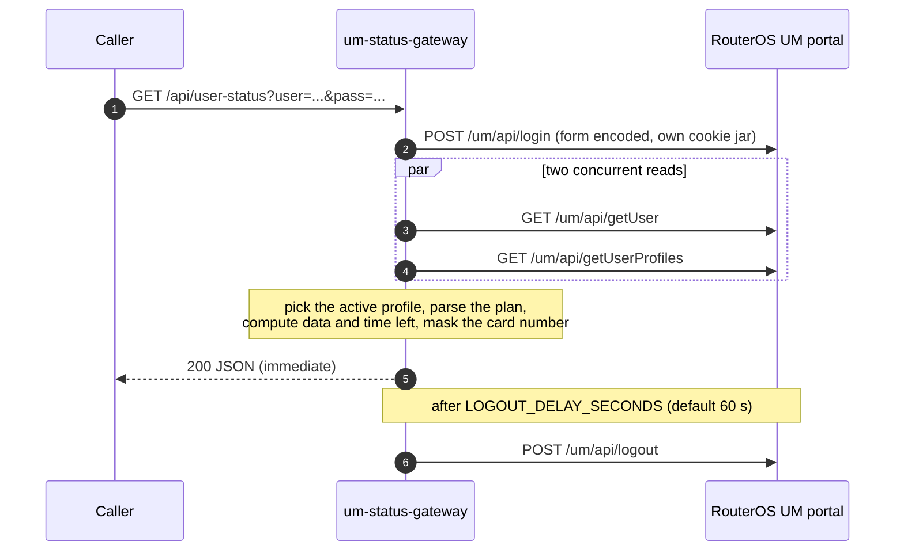

# um-status-gateway

An ultra-lightweight, on-demand HTTP gateway for the **MikroTik RouterOS v7 User Manager** web portal. It answers one question, quickly and cheaply: *how much data, time and validity is left for this card right now?*

The service is a single static Go binary, shipped as a `scratch` container image, and it does nothing until an HTTP request arrives. There is no polling loop, no background worker, no cache and no shared session: every request opens its own isolated portal session, reads the account data, computes the balances, masks the card number, schedules a delayed logout, and returns JSON that a hotspot page can render directly.

[](https://github.com/hashed-albaham/mikrotik-um-gateway/actions/workflows/docker-build.yml)

## Request lifecycle



Everything above happens inside the lifetime of a single HTTP request, except the logout, which is a single one-shot timer created per request.

## API

### `GET|POST /api/user-status?user=<card>&pass=<password>`

`/api/status` is the same endpoint under an alias. Parameters are read from the query string or, for `POST`, from a form encoded body, which keeps the password out of URLs and access logs.

| Parameter | Required | Notes |
|---|---|---|
| `user` (or `username`) | yes | Card number, up to 128 characters. Never echoed back in plain form. |
| `pass` (or `password`) | no | Portal password, up to 256 characters. Empty string is sent when omitted. |

Successful response (`200`):

```json
{
  "success": true,
  "masked_username": "00******58",
  "masked_user": "00******58",
  "profile_name": "1000-1G-8h",
  "profile_state": "active",
  "data_left": "874 MB",
  "total_data": "1 GB",
  "time_left": "6h 30m",
  "total_time": "8h",
  "total_validity": "8h",
  "remaining_validity": "6h 30m",
  "used_download": "100M",
  "used_upload": "50M",
  "used_uptime": "1h30m",
  "sessions": { "active_sessions": 2, "shared_users": 1 },
  "active_sessions": 2,
  "shared_users": 1,
  "raw": {
    "download_bytes": 104857600,
    "upload_bytes": 52428800,
    "used_data_bytes": 157286400,
    "uptime_seconds": 5400,
    "data_left_bytes": 916455424,
    "total_data_bytes": 1073741824,
    "time_left_seconds": 23400,
    "total_time_seconds": 28800,
    "remaining_validity_seconds": 23400,
    "data_unlimited": false,
    "time_unlimited": false
  },
  "limits_source": "profile-name-syntax",
  "generated_at": "2026-10-12T19:57:10Z"
}
```

Every balance is reported twice: as a short string for direct rendering, and as an exact number inside `raw`. A value of `true` in `data_unlimited` or `time_unlimited` means the plan has no cap, and the matching string is `unlimited`. When the portal did not report something, the string is `unknown` and a note appears in `warnings` instead of a guessed number.

| Field | Meaning |
|---|---|
| `masked_username`, `masked_user` | Card number with the middle removed (`0018067158` → `00******58`). The plain value is never returned. |
| `profile_name` | The plan assigned to the card, for example `1000-1G-8h`. |
| `profile_state` | `active`, `expired`, or `unknown`. A portal state of `3`, the word `used`, or an elapsed expiry all mean `expired`. |
| `data_left`, `total_data` | Plan allowance minus (download + upload), and the allowance itself. |
| `time_left`, `total_time` | Plan duration minus used uptime, and the duration itself. |
| `total_validity` | Alias of `total_time`, kept so both client generations work. |
| `remaining_validity` | Remaining time reported by the portal (`expAfter`); falls back to the plan arithmetic when the portal sends none. `validity_ends_at` is filled when the value was an absolute date. |
| `used_download`, `used_upload`, `used_uptime` | Counters exactly as the portal reported them. |
| `sessions.active_sessions`, `sessions.shared_users` | Current sessions and the simultaneous session allowance. Also mirrored at the top level. |
| `raw` | Exact numbers: bytes for traffic, seconds for time. `-1` means unlimited. |
| `limits_source` | Where the plan limits came from: `profile-name-syntax`, or `unavailable`. |
| `warnings` | Present only when part of the picture was missing. |

Error responses use a stable machine readable code:

```json
{ "success": false, "code": "invalid_credentials", "error": "the user manager rejected these credentials" }
```

| HTTP | `code` | Cause |
|---|---|---|
| 400 | `missing_user` | The `user` parameter is absent or blank. |
| 400 | `invalid_user`, `invalid_password`, `invalid_request` | A parameter is too long or the body could not be parsed. |
| 401 | `invalid_credentials` | The portal rejected the card number or password. |
| 404 | `not_found` | Unknown path. |
| 500 | `configuration_error` | No valid portal target is configured. |
| 502 | `login_failed`, `fetch_failed` | The portal was unreachable or did not answer with usable JSON. |

Responses carry `Access-Control-Allow-Origin` (default `*`), `Cache-Control: no-store` and `Vary: Origin`, so a hotspot page can call the service from the browser. Error bodies never contain the card number, the password, or portal prose.

### `GET /healthz`

Returns `{"status":"ok","logout_delay_seconds":60}`. Useful for container health checks.

## Configuration

| Variable | Default | Description |
|---|---|---|
| `UM_TARGET_URL` | – | Full portal URL, for example `http://192.168.216.1:12008`. Takes priority over the parts below. |
| `UM_HOST` | *(required unless `UM_TARGET_URL` is set)* | Portal host. May carry its own scheme and port. |
| `UM_PROTO` | `http` | Scheme used when `UM_HOST` has none. |
| `UM_PORT` | – | Portal port, appended when `UM_HOST` does not already carry one. |
| `UM_INSECURE_SKIP_VERIFY` | `true` | Accept the self signed certificate RouterOS usually serves. Set to `false` when your portal has a verifiable certificate. |
| `LISTEN_ADDR` | `:8080` | Address the HTTP API binds to. `PORT` is accepted as an alternative. |
| `LOGOUT_DELAY_SECONDS` | `60` | Delay before the portal session of a request is invalidated. `0` disables the delayed logout. |
| `REQUEST_TIMEOUT_SECONDS` | `6` | Budget for the login plus the two reads. |
| `ALLOWED_ORIGIN` | `*` | Value of `Access-Control-Allow-Origin`. Set the exact hotspot origin in production. |
| `RELEASE_MEMORY_ON_SESSION_END` | `true` | Return the memory of a finished session to the operating system right after its delayed logout, and close idle sockets. This is what keeps the footprint flat on a router. |
| `GOGC`, `GOMEMLIMIT` | `20`, `4MiB` | Go runtime tuning baked into the image. Override to trade latency for an even smaller heap. |

## Build and run

Local run against a real router:

```bash
go build -o bin/um-status-gateway .
UM_HOST=192.168.216.1 UM_PORT=12008 ./bin/um-status-gateway
curl "http://127.0.0.1:8080/api/user-status?user=0018067158&pass=secret"
```

Try it without a router: the repository ships a development stub of the portal in the documented shape, and the same stub in the older flat shape.

```bash
python3 scripts/mock-um-portal.py 8099 &
UM_HOST=http://127.0.0.1:8099 ./bin/um-status-gateway
curl "http://127.0.0.1:8080/api/user-status?user=0018067158&pass=demo"

PORTAL_SHAPE=legacy python3 scripts/mock-um-portal.py 8098 &
```

Container:

```bash
docker build -t um-status-gateway .
docker run --rm -p 8080:8080 -e UM_HOST=192.168.216.1 -e UM_PORT=12008 um-status-gateway
# or
docker compose up --build
```

Multi-architecture build and publish:

```bash
make image-multiarch IMAGE=ghcr.io/hashed-albaham/mikrotik-um-gateway TAG=latest
```

## Deploy on MikroTik RouterOS v7

Run these on the router. Replace `disk1` with your storage and `192.168.88.1` with the router's LAN address.

```routeros
# 1. Enable container mode (requires a physical confirmation, see the RouterOS docs).
/system/device-mode/update container=yes

# 2. Give the container its own network.
/interface/veth/add name=veth1 address=172.17.0.2/24 gateway=172.17.0.1
/interface/bridge/add name=containers
/ip/address/add address=172.17.0.1/24 interface=containers
/interface/bridge/port/add bridge=containers interface=veth1
/ip/firewall/nat/add chain=srcnat action=masquerade src-address=172.17.0.0/24

# 3. Environment variables. The portal of this router listens on 192.168.216.1:12008;
#    adjust UM_HOST, UM_PORT and UM_PROTO to your own portal.
/container/envs/add list=ENV_UMGW key=UM_HOST value="192.168.216.1"
/container/envs/add list=ENV_UMGW key=UM_PORT value="12008"
/container/envs/add list=ENV_UMGW key=UM_PROTO value="http"
/container/envs/add list=ENV_UMGW key=LOGOUT_DELAY_SECONDS value="60"
/container/envs/add list=ENV_UMGW key=ALLOWED_ORIGIN value="*"

# 4. Point the container engine at GHCR and add the container.
/container/config/set registry-url=https://ghcr.io tmpdir=disk1/tmp memory-high=64M
/container/add remote-image=ghcr.io/hashed-albaham/mikrotik-um-gateway:latest \
    interface=veth1 root-dir=disk1/images/umgw envlist=ENV_UMGW name=umgw \
    start-on-boot=yes logging=yes

# 5. Wait for status=stopped (download and extraction finished), then start it.
/container/print
/container/start umgw

# 6. Let hotspot clients reach the service through the walled garden.
/ip/hotspot/walled-garden/ip/add action=accept dst-address=172.17.0.2 dst-port=8080 protocol=tcp comment="UM status gateway"

# 7. Optional: publish the API on the router's LAN address as well.
/ip/firewall/nat/add chain=dstnat action=dst-nat protocol=tcp dst-address=192.168.88.1 \
    dst-port=8080 to-addresses=172.17.0.2 to-ports=8080

# Operations
/container/print
/container/log/print            # when logging=yes
/container/shell umgw
/container/update umgw          # pull a newer image tag
/container/stop umgw
```

If the GHCR package is private, the router needs credentials: `/container/config/set username=<github-user> password=<token>` (RouterOS 7.8 or newer). Making the package public removes that step.

### Hotspot balance page

`examples/hotspot-balance-check.html` is a ready widget for `login.html` or `status.html`. Copy the marked block into the hotspot page, set `API_BASE` to the address the client device can reach (normally the container address, `http://172.17.0.2:8080`), and make sure step 6 above is in place. It renders the masked card number, remaining data and time, remaining validity, subscription state and the active session count, all in Arabic with right-to-left layout and no external dependencies.

## CI/CD

`.github/workflows/docker-build.yml` runs on every push to `main`, every `v*` tag, every pull request, and on manual dispatch.

1. **Vet and test** — `gofmt` check, `go vet`, `go test -race`.
2. **Build and publish** — QEMU plus Buildx build `linux/amd64`, `linux/arm64` and `linux/arm/v7` in one pass with the GitHub Actions layer cache, push to `ghcr.io/<owner>/<repo>` using `docker/metadata-action` tags (`main`, `latest` on the default branch, the tag name, and the commit SHA), then build the `amd64` image again and **fail the job if it is 10 MiB or larger**.

After the first successful run, make the package public under *Package settings* in the repository sidebar if the router should pull it without credentials.

## Verification

The numbers below were measured on `linux/amd64` with Go 1.27.2 in a standard cloud sandbox, using the committed scripts.

| Check | Command | Result |
|---|---|---|
| Tests | `go test -race -count=1 ./...` | pass: masking, plan syntax, validity parsing, URL resolution, end-to-end flow, POST and alias path, expiry, legacy response shape, validation, health, concurrency isolation |
| Handler benchmark | `go test -run '^$' -bench BenchmarkStatusEndpoint -benchtime=300x` | ~0.52 ms/op, ~75 KB/op, 695 allocs/op against an in-process portal |
| Stripped binary | `make size` | 6.95 MiB (7,282,848 bytes), static, `CGO_ENABLED=0`, `-trimpath -s -w` |
| Resident memory | `make rss` | 8.49 MiB after start, 9.16 MiB after 100 status requests |
| Image size | CI job *Verify the image footprint stays under 10 MiB* | 7 MiB `amd64` image (7,448,188 bytes), enforced by the pipeline on every build |

Memory is measured with `scripts/measure-memory.sh`, which starts the mock portal and the gateway, drives a burst of requests, waits for the delayed logouts to finish, and reads `VmRSS` from `/proc`. The `scratch` base image means the resident set is essentially the binary's text pages plus a heap bounded by `GOMEMLIMIT`.

## Design notes and assumptions

**Portal contract.** Login and logout are `POST` requests with a form encoded body (`username`, `password`), and both reads are session scoped `GET`s that carry no account identifier: `/um/api/getUser` and `/um/api/getUserProfiles`. The counters are read from `data.download`, `data.upload`, `data.uptime`, `data.activeSess` and `data.sharedUsers`; the profile rows come from `data.profiles[]`, where `state` is a number (`3` meaning used up) and `expAfter` holds the remaining validity.

**Tolerant parsing.** Responses differ between RouterOS builds. The gateway decodes the documented shape first — one pass, no reflection-heavy map walking — and only when a value is missing does it fall back to a generic walk that matches keys case-insensitively and treats `-`, `_` and spaces as equivalent (`download-used`, `downloadUsed` and `download_used` are the same key). Alias priority is deterministic, so a row that carries both `profile` (the plan) and `name` (the account) is read correctly. When neither shape yields a plan, the balances come back as `unknown` with a warning instead of a wrong number.

**Profile name syntax.** Plan limits are read from the name of the profile that is currently in use. Every token separated by `-`, `_`, `/` or a space is classified on its own, so `1000-1G-8h` means price 1000, 1 GiB of data and 8 hours, while `1000-un-8h` means unlimited data and 8 hours. `un`, `unl`, `unlimited`, `inf` and `infinite` are read as unlimited, data suffixes `K/M/G/T` are binary, and durations accept `1w2d3h4m5s` or `08:30:00` forms. A row whose expiry cannot be parsed is passed through as text rather than discarded.

**Choosing the profile.** A card can hold several profiles, and only one is in use. The gateway prefers a profile that is not used up and that actually names a plan, so a spent profile does not shadow the active one.

**Privacy.** The card number is masked as `first two characters + asterisks + last two characters`; numbers of four characters or fewer are masked completely. The password is used once, is never logged and never returned, and the login travels in a request body rather than a URL. Errors and log lines only carry the masked number.

**No background work.** All work happens in the request that triggered it. The only timer is the single one-shot `time.AfterFunc` that performs the required delayed logout; after it has logged out, it also closes the client's idle sockets and, when `RELEASE_MEMORY_ON_SESSION_END` is enabled, returns the memory of that session to the operating system.

**Two portal calls, not three.** The plan limits come from the profile name and the session data comes from the two reads above, so the gateway never queries the portal for anything it does not need. That is one fewer round trip per request than a three-call design.

## Security

- Keep the gateway on a trusted network, or publish it behind a reverse proxy with TLS. A hotspot page is a public page, so anyone who can reach the service can query a card number they know.
- Set `ALLOWED_ORIGIN` to the exact hotspot origin to stop other sites from reading responses through a victim's browser.
- `UM_INSECURE_SKIP_VERIFY` defaults to `true` because RouterOS portals normally present a self signed certificate. Turn it off when your portal has a certificate you can verify.
- The container runs as `nobody` (`USER 65534:65534`) on a read-only root filesystem, with no shell and no package manager.
- `docker-compose.yml` limits the container to 16 MiB of RAM and mounts `/tmp` as tmpfs.

## Project layout

```
main.go                          HTTP server, routing, CORS, request handler, delayed logout
um.go                            User Manager client: form login, portal contract, tolerant fallbacks
buildstatus.go                   profile selection, balances, public payload
parse.go                         plan syntax, byte and duration formatting, masking
main_test.go                     unit and end-to-end tests plus the handler benchmark
scripts/mock-um-portal.py        development stub of the portal, both response shapes
scripts/measure-memory.sh        resident memory measurement
examples/hotspot-balance-check.html   hotspot widget for the balance page
Dockerfile                       multi-stage build, static binary, scratch runtime
.github/workflows/docker-build.yml    multi-arch build and publish to GHCR
```

## License

MIT, see [LICENSE](LICENSE).
